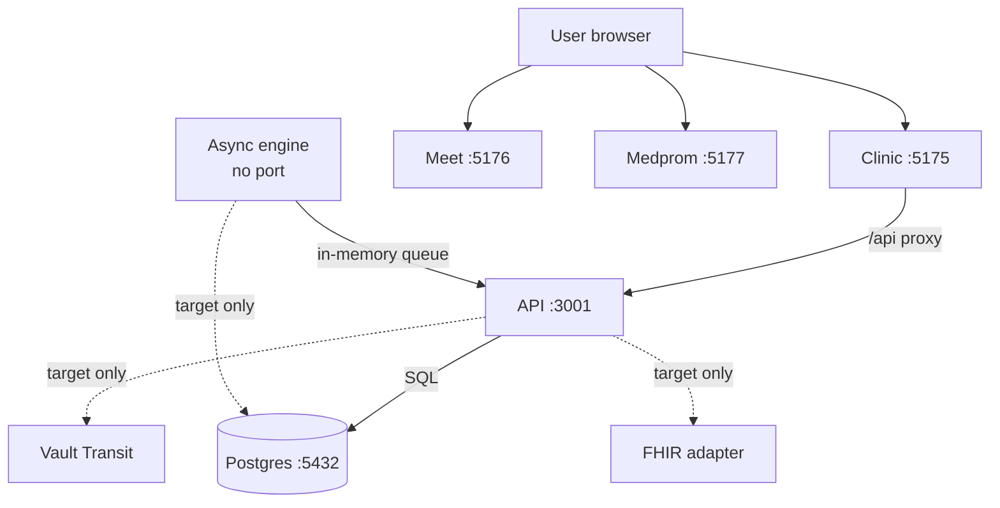
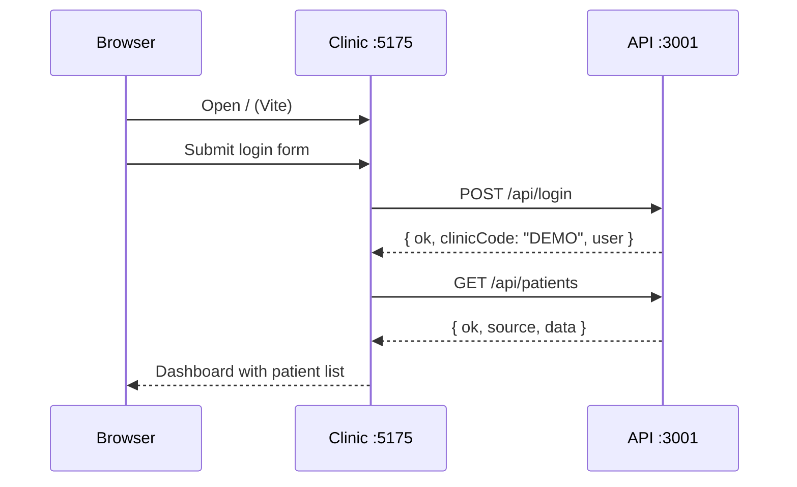
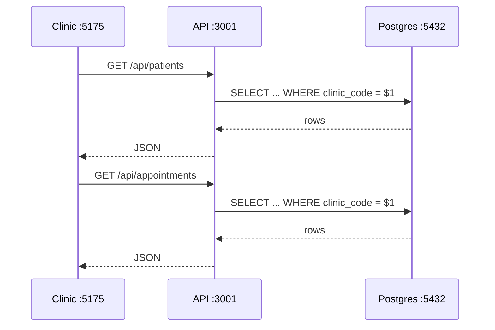
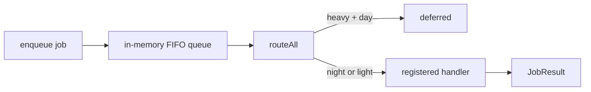

# ARCHITECTURE — SOVEREIGN

This document describes the architecture that exists in this repository today, and clearly separates it from the target architecture. It is based on the code, not on aspirational README claims.

---

## 1. Purpose and constraints

SOVEREIGN is a sovereign medical platform that combines:

- **Clinic** — patient records and appointments.
- **Meet** — video consultation rooms.
- **Medprom** — medical promotion / directory.
- **API** — business logic and data access.
- **Async engine** — heavy background work at night.
- **Postgres** — main database.
- **Vault Transit** — target encryption layer for phone/PII and prescriptions.

Design constraints from the project rules:

- No real patients; only the synthetic test patient `Test Test`, `1990-01-01`.
- Clinic isolation by `clinic_code`.
- Prescriptions must be stored encrypted.
- Heavy jobs only between **23:00 and 06:00** local time.
- Secrets only in `.env` or a vault; `.env` never committed.
- Test data and demo credentials must not be presented as production-ready.

---

## 2. Runtime topology



### Current runtime

| Component | Port | Process | Status |
| --- | ---: | --- | --- |
| Clinic | 5175 | Vite dev server | Not running in the current environment |
| Meet | 5176 | Vite dev server | Not running in the current environment |
| Medprom | 5177 | Vite dev server | Not running in the current environment |
| API | 3001 | Node + Express | Running |
| Postgres | 5432 | PostgreSQL 16 | Running |
| Async engine | none | Library | No worker process |
| Vault Transit | none | External service | Not integrated |
| RC | none | No such service | Not found |

---

## 3. Directory layout

```text
sovereign/
├── apps/
│   ├── api/                  Express API (:3001)
│   │   ├── package.json
│   │   └── src/index.mjs
│   ├── clinic/               Clinic Vite+React (:5175)
│   │   ├── src/App.tsx
│   │   ├── src/api.ts
│   │   ├── vite.config.ts
│   │   └── dist/
│   ├── meet/                 Meet Vite+React (:5176)
│   │   ├── src/App.tsx
│   │   ├── vite.config.ts
│   │   └── dist/
│   └── medprom/              Medprom Vite+React (:5177)
│       ├── src/App.tsx
│       ├── vite.config.ts
│       └── dist/
├── packages/
│   ├── async-engine/         Queue, router, night window
│   │   └── src/{index,types,queue,router,night_shift}.ts
│   └── db/                   Postgres pool, queries, migrations
│       ├── src/index.ts
│       └── scripts/migrate.mjs
├── db/
│   └── migrations/
│       └── 0001_init.sql
├── src/
│   ├── data/mockData.ts      Demo/fallback data and example SQL
│   ├── services/sqliteWasm.ts Browser-local SQLite WASM cache
│   └── types.ts
├── package.json              npm workspaces + turbo scripts
├── turbo.json                Dev/build task graph
├── .env.example              Placeholders only
├── .gitignore
├── README.md
├── ARCHITECTURE.md
├── FUNCTIONS.md
├── IDEAS.md
├── TASKS.md
├── LOGS.md
└── SECURITY.md
```

The `packages/ui` directory mentioned in older notes does not exist. Built `dist/` folders exist locally but are ignored by git.

---

## 4. Services

### 4.1 Clinic — port 5175

- **Technology:** Vite 6 + React 18 + TypeScript.
- **Entry point:** `apps/clinic/src/main.tsx` → `App.tsx`.
- **What it does:** login form, calls `POST /api/login`, then loads patients from `GET /api/patients`.
- **API access:** Vite dev proxy forwards `/api` and `/health` to `http://localhost:3001`.
- **Fallback:** if the API is unreachable, `apiLogin` accepts the hardcoded demo credentials and `apiPatients` returns three mock patients from `src/data/mockData.ts`.
- **User:** clinic doctor / clinic staff.
- **Not implemented:** patient CRUD, appointment UI, prescriptions UI, search, pagination, audit, real session.

### 4.2 Meet — port 5176

- **Technology:** Vite 6 + React 18 + TypeScript.
- **Entry point:** `apps/meet/src/main.tsx` → `App.tsx`.
- **What it does:** mock login and a test room placeholder (`TEST-ROOM-01`).
- **User:** doctor / patient.
- **Not implemented:** WebRTC, room lifecycle, chat, screen sharing, recording, scheduling, waiting room, consent, DB.

### 4.3 Medprom — port 5177

- **Technology:** Vite 6 + React 18 + TypeScript.
- **Entry point:** `apps/medprom/src/main.tsx` → `App.tsx`.
- **What it does:** mock login and a "promos" placeholder heading.
- **User:** medical promoter / directory visitor.
- **Not implemented:** directory, search, profiles, promotions, leads, reviews, analytics, DB.

### 4.4 API — port 3001

- **Technology:** Node.js + Express 4 + `pg` + `dotenv`.
- **Entry point:** `apps/api/src/index.mjs`.
- **Data access:** imports `@sovereign/db/dist/index.js`.
- **Configuration:** loads `.env` from the repo root; `API_PORT` defaults to `3001`.
- **User:** frontends and operators.
- **Endpoints:** see section 6.
- **Not implemented:** real auth, token/session, RBAC, CORS policy, rate limiting, security headers, request validation library, structured logging, 404 JSON handler, error sanitization.

### 4.5 Postgres — port 5432

- **Technology:** PostgreSQL 16, local instance.
- **Database:** `sovereign` (not created in the current environment).
- **Schema management:** `db/migrations/*.sql`, applied by `packages/db/scripts/migrate.mjs`, tracked in `schema_migrations`.
- **User:** API and migration runner.
- **Connection:** `DATABASE_URL` only; no hardcoded connection string in source.
- **Not implemented:** RLS policies, backup automation, retention policy, connection pooling beyond `max: 5`.

### 4.6 Async engine — no port

- **Technology:** TypeScript library, no server process.
- **What it does:**
  - `enqueue` adds a job to an in-memory FIFO queue.
  - `dequeue`, `pendingCount`, `peekAll`, `drain` manage the queue.
  - `registerHandler` maps a `JobKind` to a handler.
  - `routeAll` runs jobs; heavy jobs outside the night window are deferred.
  - `isNightNow`, `canRunHeavy`, `nextNightWindow` implement **23:00–06:00**.
- **Job kinds:** `backup`, `report`, `embed`, `cleanup`.
- **Not implemented:** persistence, worker entry point, retries, dead-letter queue, metrics, handlers for any job kind.

### 4.7 Vault Transit — no port

- **Status:** not implemented in this repo.
- No Vault client, no transit path, no phone field, no encryption/decryption code.
- The schema has `prescriptions.encrypted_blob BYTEA`, but nothing writes to it.
- Treat Vault as **target architecture** until code and tests exist.

### 4.8 RC — no port

- **Status:** not found.
- There is no service, package, route or script named RC.
- `packages/async-engine` is the only asynchronous component. If RC is a required capability, it is a gap, not a delivered feature.

---

## 5. Request flows

### 5.1 Clinic login



If the API is unreachable, the clinic client accepts the hardcoded demo login and returns mock patients with `source: "mock-fallback"`. This fallback is silent; there is no offline banner.

### 5.2 Patients and appointments



The API hardcodes `DEMO_CLINIC = 'DEMO'` for all three data endpoints. There is no path parameter or session-derived clinic code.

### 5.3 Meet and Medprom

Both are browser-only mock apps. They do not call the API and do not touch Postgres. Their only shared behavior is the demo login check inside each React component.

### 5.4 Async engine



No code currently calls `enqueue` or registers a handler outside the package itself. The engine is a tested library, not a running worker.

---

## 6. API surface

| Method | Path | Request | Response | Notes |
| --- | --- | --- | --- | --- |
| GET | `/health` | none | `{ ok, db: { ok, detail } }` | Returns 200 even when `db.ok` is false |
| POST | `/api/login` | `{ login, password }` | `{ ok, clinicCode, user }` or 401 | Hardcoded demo credentials |
| GET | `/api/patients` | none | `{ ok, source, data }` or 500 | `clinic_code = DEMO` |
| GET | `/api/appointments` | none | `{ ok, source, data }` or 500 | Latest 50, `clinic_code = DEMO` |
| POST | `/api/appointments` | `{ patientId, startsAt, note? }` | `{ ok, source, data }` or 400/500 | No auth, no doctor assignment |
| any | unknown | none | Express default 404 HTML | No JSON error contract |

Error responses use `String(err)`. This can expose database details to the client and should be replaced with a sanitized error handler.

---

## 7. Data schema

### 7.1 Postgres main schema

Migration: `db/migrations/0001_init.sql`.

#### `clinics`

| Column | Type | Constraints |
| --- | --- | --- |
| `clinic_code` | TEXT | Primary key |
| `name` | TEXT | Not null |
| `created_at` | TIMESTAMPTZ | Not null, default `now()` |

#### `doctors`

| Column | Type | Constraints |
| --- | --- | --- |
| `id` | UUID | Primary key, default `gen_random_uuid()` |
| `clinic_code` | TEXT | Not null, FK → `clinics.clinic_code`, cascade delete |
| `login` | TEXT | Not null |
| `password_hash` | TEXT | Not null |
| `full_name` | TEXT | Not null, default empty |
| `created_at` | TIMESTAMPTZ | Not null, default `now()` |
| — | — | Unique `(clinic_code, login)` |

The migration comment says a demo doctor should be seeded, but the actual seed does **not** insert a doctor. No password hash exists in the schema.

#### `patients`

| Column | Type | Constraints |
| --- | --- | --- |
| `id` | UUID | Primary key, default `gen_random_uuid()` |
| `clinic_code` | TEXT | Not null, FK → `clinics.clinic_code`, cascade delete |
| `full_name` | TEXT | Not null |
| `dob` | DATE | Not null |
| `created_at` | TIMESTAMPTZ | Not null, default `now()` |

Index: `patients_clinic_idx (clinic_code)`.

#### `appointments`

| Column | Type | Constraints |
| --- | --- | --- |
| `id` | UUID | Primary key, default `gen_random_uuid()` |
| `clinic_code` | TEXT | Not null, FK → `clinics.clinic_code`, cascade delete |
| `patient_id` | UUID | Not null, FK → `patients.id`, cascade delete |
| `doctor_id` | UUID | FK → `doctors.id`, set null on delete |
| `starts_at` | TIMESTAMPTZ | Not null |
| `note` | TEXT | Not null, default empty |
| `created_at` | TIMESTAMPTZ | Not null, default `now()` |

Index: `appointments_clinic_idx (clinic_code, starts_at)`.

#### `prescriptions`

| Column | Type | Constraints |
| --- | --- | --- |
| `id` | UUID | Primary key, default `gen_random_uuid()` |
| `clinic_code` | TEXT | Not null, FK → `clinics.clinic_code`, cascade delete |
| `patient_id` | UUID | Not null, FK → `patients.id`, cascade delete |
| `doctor_id` | UUID | FK → `doctors.id`, set null on delete |
| `encrypted_blob` | BYTEA | Not null |
| `created_at` | TIMESTAMPTZ | Not null, default `now()` |

Index: `prescriptions_clinic_idx (clinic_code)`.

No encryption code exists. No API or UI reads or writes prescriptions.

#### `schema_migrations`

| Column | Type | Constraints |
| --- | --- | --- |
| `name` | TEXT | Primary key |
| `applied_at` | TIMESTAMPTZ | Not null, default `now()` |

#### Seed data

- Clinic `DEMO` with name `Demo Clinic`.
- Patient `Test Test`, date of birth `1990-01-01`.
- No doctor seed.
- No prescription seed.

#### Row-level security

Not implemented. Isolation relies on every query filtering by `clinic_code`. The API currently hardcodes `DEMO`, so there is no multi-clinic request path yet.

### 7.2 Browser-local SQLite WASM schema

Defined in `src/services/sqliteWasm.ts`; used as a browser-local cache, not the server source of truth.

| Table | Columns | Purpose |
| --- | --- | --- |
| `local_client_notes` | `id`, `title`, `content`, `tags`, `created_at` | Local notes |
| `browser_cache_metrics` | `id`, `operation`, `latency_us`, `wasm_status`, `timestamp` | Local performance metrics |
| `opfs_vector_store` | `id`, `label`, `dim_count`, `l2_norm`, `created_at` | Local vector cache metadata |

The module loads `sql.js` from a public CDN. This is a third-party network dependency and should be self-hosted for a sovereign deployment.

### 7.3 Example SQL in mock data

`src/data/mockData.ts` contains illustrative SQL, not migrations:

| Table | Purpose |
| --- | --- |
| `knowledge_base` | Example pgvector embedding table |
| `prompt_logs` | Example prompt telemetry ledger |
| `local_cache` | Example key/value cache |
| `custom_prompt_templates` | Example prompt templates |

These tables are not created by the migration runner and are not part of the clinic schema.

---

## 8. Security architecture

### 8.1 Current state

| Area | Current state |
| --- | --- |
| Authentication | Hardcoded demo login; no token or session |
| Authorization | None; API always uses `DEMO` |
| Transport | HTTP on localhost; no TLS configuration |
| CORS | No CORS middleware |
| Security headers | None |
| Rate limiting | None |
| Input validation | Minimal required-field checks |
| Error handling | Returns `String(err)` to clients |
| Logging | `console.log` only; no structure, redaction or rotation |
| Secrets | `.env` exists locally and is ignored by git; contents are not documented |
| Encryption | No Vault integration; prescriptions schema only |
| FHIR | No adapter or resources |
| Audit | No audit table or event stream |
| Clinic isolation | Application-level `clinic_code`; no RLS |

### 8.2 Target state

- Vault Transit for phone/PII and prescription encryption.
- Real authentication with hashed passwords, short-lived sessions and refresh rotation.
- RBAC for doctor, clinic admin, operator and patient.
- RLS policies keyed by `clinic_code`.
- FHIR adapter for BE/CH/IL interoperability.
- TLS termination at a reverse proxy; CORS allowlist; security headers.
- Structured logs with request IDs, redaction and retention.
- Audit events for login, record access, prescription access and admin actions.

The target state must be implemented and tested before it is described as delivered.

---

## 9. Configuration

| Variable | Required | Consumer | Default | Notes |
| --- | --- | --- | --- | --- |
| `DATABASE_URL` | Yes for DB | `packages/db`, migration runner | none | Full Postgres connection string |
| `API_PORT` | No | API | `3001` | `PORT` is not read by the API |
| `DEMO_LOGIN` | No | Documentation only | none | API does not read it |
| `DEMO_PASSWORD` | No | Documentation only | none | API does not read it |

A local `.env` exists and is ignored by git. Its contents are not documented or reproduced here. Use `.env.example` as the only documented template.

---

## 10. Deployment notes

There is no production deployment configuration in this repo:

- No Dockerfile or compose file.
- No reverse proxy configuration.
- No process manager configuration.
- No TLS certificates.
- No CI pipeline.
- No backup job.
- No log shipping.

A production deployment must add these before handling any real patient data.

---

## 11. Architectural gaps

1. Database `sovereign` is missing; API data endpoints return 500.
2. Health check returns 200 while the database is down.
3. No real authentication or authorization.
4. No Vault Transit or encryption implementation.
5. No FHIR implementation.
6. No RLS; API hardcodes `DEMO`.
7. No Medprom domain model.
8. No Meet WebRTC.
9. No prescription API/UI.
10. No structured logging or audit trail.
11. No RC service.
12. No automated tests.
